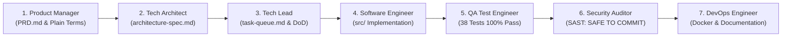

# Real-Time Deep Learning Road Lane Detection & Autonomous Driving Telemetry System

[]()
[](https://www.python.org/)
[](https://pytorch.org/)
[](https://opencv.org/)
[](https://streamlit.io/)
[](https://www.docker.com/)
[-brightgreen.svg)]()
[]()

Production-grade real-time computer vision and deep learning system for road lane detection, vehicle lateral position tracking, and Lane Departure Warning (LDW). Designed for autonomous driving assistance (ADAS) with an intuitive, human-friendly web telemetry dashboard.

---

## 🤖 Engineered via the 7-Agent Master SDLC Framework (`MASTER_SDLC_AGENTS`)

This project was developed, tested, and released end-to-end under the autonomous governance of the **`MASTER_SDLC_AGENTS`** multi-agent engineering framework with strict **Human-in-the-Loop (HITL)** quality gates:



| Phase | Autonomous SDLC Agent | Core Mission & Deliverables | HITL Gate Status |
| :---: | :--- | :--- | :---: |
| **1** | **Product Manager Agent** | Authored `PRD.md` with functional/non-functional ADAS specs and Section 7 plain-English parameter glossary with bracketed tooltips. | **APPROVED (Gate 1)** |
| **2** | **Technical Architect Agent** | Authored `architecture-spec.md` with 4-tier perception pipeline, vanishing-point line geometry, and telemetry contracts. | **APPROVED (Gate 2)** |
| **3** | **Tech Lead Agent** | Authored `task-queue.md` structuring Tasks 1 through 7 with strict data contracts and Definition of Done. | **APPROVED (Gate 3)** |
| **4** | **Software Engineer Agent** | Implemented `src/utils.py`, `src/detector.py`, and `src/app.py` (ResNet backbone, HLS segmentation, Hough clustering, AR corridor, HUD). | **APPROVED (Gate 4)** |
| **5** | **QA / Test Engineer Agent** | Authored `tests/` with 38 unit and integration tests (100% passing) and verified all visual benchmark outputs. | **APPROVED (Gate 5)** |
| **6** | **Security Auditor Agent** | Audited AST for code injection, hardened decompression bombs (`Image.MAX_IMAGE_PIXELS = 50M`), issued `SAFE TO COMMIT`. | **APPROVED (Gate 6)** |
| **7** | **DevOps & Release Agent** | Authored `Dockerfile`, `docker-compose.yml`, Detailed Design Documents (`.docx`, `.pdf`), Customer Handover Guides, and pushed to GitHub. | **APPROVED (Gate 7)** |

### 📜 Multi-Agent Governance Rules (`.gemini` Master Rules Engine)

The development lifecycle was strictly governed by global rule directives (`sdlc_master_framework.md` configured in `.gemini`), enforcing rigorous software engineering discipline, determinism, and zero hallucination:

1. **Strictly One File / One Task at a Time:** The agent is prohibited from batching code generation across multiple files. Every single component must be authored, verified, and confirmed before proceeding.
2. **Mandatory Human-in-the-Loop (HITL) Quality Gates:** The agent must pause at the conclusion of each phase (Gates 1 through 7) and obtain explicit user sign-off before advancing. Autonomous phase jumping is strictly blocked.
3. **Strict Role Separation & Code Freeze:** Each agent operates strictly within its designated role. During Phase 5 (QA Testing), a strict code freeze is enforced on `src/` to prevent test-time regressions.
4. **End-User Centricity Mandate:** All perception metrics and parameter controls must be translated into plain English with bracketed guidance tooltips, eliminating confusing calculus equations or raw developer jargon.
5. **100% Verified Automated Coverage:** Reaching 100% passing automated test coverage across unit and integration suites is an absolute prerequisite before entering security audits.
6. **Defense-in-Depth Security:** Every file upload path and memory buffer must undergo SAST scans for code execution vectors, memory leak prevention, and decompression bomb protection (`Image.MAX_IMAGE_PIXELS = 50,000,000`).
7. **Turnkey Enterprise Documentation:** The DevOps release agent must deliver production containerization alongside formal Detailed Design Documents and Customer Handover Manuals in both `.docx` and `.pdf` formats.

---

## 🌟 Key Capabilities

* **Vanishing-Point Constrained Line Detection:** Clustered Hough transform bound to road horizon and vanishing point prevents parabolic looping or ballooning artifacts into the sky.
* **Dual-Spectrum Paint Filtering:** Combines HLS color isolation (tuned for yellow and white lane paint) with adaptive Canny edge gradients.
* **Real-Time Telemetry HUD:** Renders an Augmented Reality (AR) drivable corridor, electric blue left boundary, amber right boundary, and real-time Heads-Up Display directly on road video.
* **Autonomous Metrics:** Calculates lateral vehicle offset down to centimeters, road curvature radius, and instant Crimson Red Departure Alerts when vehicle drifts over lines.
* **Temporal EMA Filtering:** Exponential moving average line smoothing stabilizes line tracking across bumpy roads and vibrations.
* **1-Click Telemetry Export:** Download full frame-by-frame RFC 4180 CSV logs with timestamps, lane positions, and departure flags.

---

## 🚗 User Guide: Intuitive Dashboard Parameters

All metrics and controls are written in plain, human-friendly English with bracketed tooltips for non-technical drivers:

### 1. Perception Dashboard Metric Cards

| Metric Card | What It Displays | Meaning to the Driver |
| :--- | :--- | :--- |
| **Camera Tracking** | `🟢 LOCKED (Both Lane Lines Tracked)`<br>`⚪ SEARCHING (Scanning Road / No Lines Found)` | Confirms whether camera clearly detects and tracks both lane lines or if markings are obscured (snow, dirt, intersections). |
| **Vehicle Lane Position** | `✅ Centered (e.g. 0.04m right of center)`<br>`⚠️ Drifting Right/Left (> 0.12m)` | Shows how close the vehicle is to the center of the lane down to centimeters. |
| **Road Shape Ahead** | `🛣️ Straight Road (No curve ahead)`<br>`↪️ Gentle Curve (Turning radius: 1200m)`<br>`⚠️ Sharp Turn (Sharp curve: 450m)` | Plain-English road trajectory ahead without confusing calculus equations. |
| **Driver Safety Alert** | `✓ SAFE IN LANE (Normal)`<br>`🚨 DEPARTURE ALERT! (Flashing red)` | Green confirmation when inside lane; flashes red alert when car drifts across boundaries. |

### 2. Driver Assistance Settings (Sidebar Sliders)

| Slider Name | Default | When to Adjust? |
| :--- | :---: | :--- |
| **🎯 Paint Detection Sensitivity (Lower = Faded Paint \| Higher = Ignore Cracks)** | `0.40` | Slide **LEFT (0.20)** for worn-out, faded road paint.<br>Slide **RIGHT (0.60)** to ignore asphalt tar cracks or skid marks. |
| **🛡️ Line Stability (Lower = Quick Steering \| Higher = Anti-Shake on Bumps)** | `0.35` | Slide **RIGHT (0.70)** on bumpy roads to stop lines from vibrating.<br>Slide **LEFT (0.20)** for instant response during quick swerves. |
| **🔔 Departure Warning Alarm (Strict: 0.15m \| Normal: 0.25m \| Relaxed: 0.40m)** | `0.25m` | **Strict (0.15m):** Narrow canyon road with no margin for error.<br>**Normal (0.25m):** Standard highway.<br>**Relaxed (0.40m):** Wide lanes. |
| **💡 Green Carpet Brightness (Adjust Visual Glow on Road)** | `0.32` | Adjusts AR drivable corridor opacity between subtle overlay and bright neon carpet. |
| **⏱️ Video Clip Length (Short 2s: 60 \| Standard 4s: 120 \| Long 10s: 300)** | `120` | Limits video playback duration for quick checks vs extended drive reviews. |

---

## 🚀 Quickstart: Running the Application

### Option A: Local Python Environment (Recommended for Development)

1. **Clone the repository:**
   ```bash
   git clone https://github.com/your-org/lane-detection.git
   cd lane-detection
   ```

2. **Create and activate a virtual environment:**
   ```bash
   # Windows
   python -m venv venv
   .\venv\Scripts\activate

   # Linux / macOS
   python3 -m venv venv
   source venv/bin/activate
   ```

3. **Install dependencies:**
   ```bash
   pip install --upgrade pip
   pip install -r requirements.txt
   ```

4. **Launch the web dashboard:**
   ```bash
   streamlit run src/app.py
   ```
   Open your browser to: **`http://localhost:8501`**

---

### Option B: Docker Container (Production Deployment)

Run with Docker Compose (single command):
```bash
docker compose up --build -d
```

View container status:
```bash
docker ps
```

Access the application in your browser:
**`http://localhost:8501`**

Stop the container:
```bash
docker compose down
```

---

## 🧪 Automated Testing & Verification

The test suite contains 38 unit and integration tests covering utilities, security validations, line clustering, and real road benchmarks:

```bash
pytest -v tests/
```

**Test Coverage Summary:**
* **23 Unit Tests (`tests/test_utils.py`):** Media format verification, image normalization, video streaming, HUD overlay rendering, CSV generation.
* **15 Integration Tests (`tests/test_detector.py`):** Model initialization, state reset, candidate mask extraction, temporal EMA smoothing, straight/curved benchmark detection, LDW alert triggers.
* **Result:** **38 / 38 Passed (100% Pass Rate)**

To generate visual annotated result images for all benchmark photos:
```bash
python tests/generate_test_results.py
```
Outputs are saved to: `tests/test_results/result_*.jpg`.

---

## 📁 Repository Structure

```text
lane_detection/
├── src/
│   ├── __init__.py
│   ├── app.py              # Streamlit dashboard & end-user interface
│   ├── detector.py         # Deep learning & vanishing-point lane engine
│   └── utils.py            # Media ingestion, AR HUD renderer & CSV exporter
├── data/
│   └── sample_presets/     # Real daylight highway, canyon curve, departure MP4s/JPGs
├── tests/
│   ├── conftest.py         # Pytest environment fixtures
│   ├── generate_test_results.py # Visual QA generator
│   ├── test_detector.py    # Detector integration & regression test suite
│   ├── test_utils.py       # Media security & HUD unit test suite
│   ├── test_images/        # Pristine benchmark input road images
│   └── test_results/       # Generated visual verification result images
├── reports/
│   └── security-audit.md   # SAST and defensive security audit report
├── plans/
│   ├── PRD.md              # Product requirements & user parameter glossary
│   ├── architecture-spec.md# 4-section technical architecture specification
│   ├── task-queue.md       # Implementation task queue & DoD
│   └── detailed-design.md  # Detailed Design Document
├── Dockerfile              # Production multi-stage Docker build
├── docker-compose.yml      # Container orchestration
├── .dockerignore           # Container build exclusions
├── .gitignore              # Version control exclusions
├── requirements.txt        # Pinned Python package dependencies
├── packages.txt            # Linux runtime libraries (libgl1, libglib2.0-0)
└── README.md               # System manual & deployment documentation
```

---

## 🔒 Security & Defense-in-Depth

* **Zero Shell Execution:** No `eval()`, `exec()`, or `os.system()` calls.
* **Decompression Bomb Protection:** Pillow capped at `Image.MAX_IMAGE_PIXELS = 50_000_000`.
* **Temporary File Sandboxing:** Video buffers written to `tempfile.NamedTemporaryFile` with deterministic cleanup in `finally:` blocks.
* **Non-Root Container:** Docker container executes under unprivileged `appuser`.
* **CSV Formula Safe:** Numerical telemetry explicitly sanitized against spreadsheet injection.
